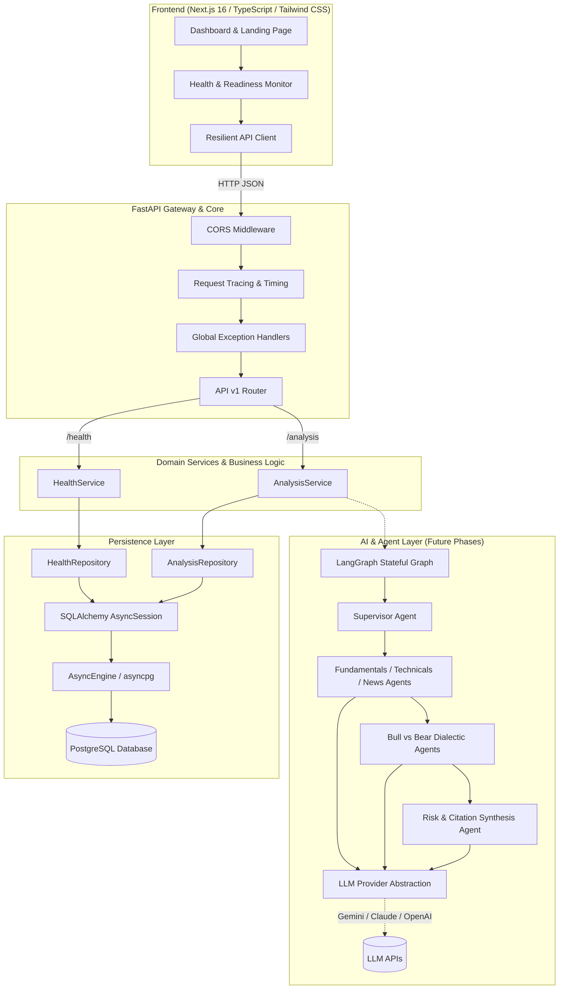

# TradeRunner — Multi-Agent Stock Analysis Platform — Architecture Specification

## 1. System Vision & Objective

The platform is an institutional-grade, AI-powered equity research platform designed to deliver evidence-backed stock analyses. Instead of relying on a single monolithic prompt, the system coordinates specialized, domain-specific AI agents that operate iteratively:
- **Gathering & verifying facts**: SEC EDGAR 10-K/10-Q filings, XBRL statements, and earnings call transcripts.
- **Performing deterministic financial calculations**: Valuation models (DCF, WACC), financial ratios, and price action metrics computed strictly in Python to prevent LLM mathematical hallucinations.
- **Conducting adversarial dialectic debate**: Bull Thesis and Bear Red-Team agents actively scrutinizing and stress-testing each other's assumptions.
- **Generating cited research reports**: Transparent citations directly linked to primary sources.

This document outlines the **foundational architecture** established in Phase 1 to support rapid agent additions, LLM provider switching, and automated orchestration workflows without structural refactoring.

---

## 2. Monorepo Structural Overview

```
stock-analysis-platform/
├── frontend/                     # Next.js 16 + React 19 + TypeScript + Tailwind CSS
│   ├── app/                      # App router layouts and pages
│   ├── components/               # Reusable UI primitives (Card, Badge, Metrics)
│   ├── features/                 # Domain feature modules (health indicator, analysis monitors)
│   ├── lib/                      # Client utilities (api-client, env)
│   └── types/                    # Shared TypeScript interfaces
├── backend/                      # Python 3.12 + FastAPI + SQLAlchemy 2.x
│   ├── app/
│   │   ├── main.py               # Application factory, lifespan, CORS, error middleware
│   │   ├── api/v1/               # HTTP route controllers (health, analysis)
│   │   ├── core/                 # Settings (pydantic-settings), logging, custom exceptions
│   │   ├── schemas/              # Pydantic v2 request/response validation models
│   │   ├── models/               # SQLAlchemy 2.0 declarative database models
│   │   ├── repositories/         # Isolated data-access layer (CRUD & health pings)
│   │   ├── services/             # Pure business logic and domain orchestration
│   │   ├── agents/               # Future specialized AI agent interfaces & classes
│   │   ├── tools/                # Deterministic math, market data, and SEC filing tools
│   │   ├── graphs/               # LangGraph stateful workflow definitions
│   │   └── database/             # Async connection pool & transactional session factory
│   ├── alembic/                  # Database migration scripts (async engine)
│   ├── tests/                    # Pytest automated test suite (isolated in-memory SQLite)
│   └── pyproject.toml            # Backend dependencies and project metadata
├── docs/                         # Architecture specifications and API contracts
│   ├── architecture.md
│   └── api-contracts.md
├── docker-compose.yml            # Local PostgreSQL 16 container definition
├── .env.example                  # Safe configuration template with placeholder credentials
├── .gitignore                    # Monorepo-wide git exclusion rules
└── README.md                     # Comprehensive developer onboarding guide
```

---

## 3. High-Level Architectural Diagram



---

## 4. Layer Responsibilities & Design Decisions

### 4.1 Frontend Layer (`frontend/`)
- **Next.js 16 (App Router)**: Utilizing React 19 server/client components and Turbopack for lightning-fast compilation.
- **Tailwind CSS v4**: Modern dark-mode palette (`slate-950`, `indigo-500`, `emerald-500`) with glassmorphic cards and subtle ambient radial glow.
- **Client Resilience**: API client provides network timeout abort controllers and standard error classification (`NETWORK_ERROR`, `TIMEOUT`, `DEGRADED`).
- **Zero Secret Exposure**: The frontend client never receives internal database credentials, stack traces, or raw exception strings.

### 4.2 API Layer (`backend/app/api/`)
- Pure controller layer. Translates HTTP requests into strongly typed Pydantic models.
- Injects database sessions via `Depends(get_db_session)`.
- Enforces HTTP status codes (`200 OK`, `201 Created`, `404 Not Found`, `422 Unprocessable Entity`, `503 Service Unavailable`).

### 4.3 Service Layer (`backend/app/services/`)
- Encapsulates domain logic without HTTP awareness.
- **Distinguishing Application Health vs Dependency Health**:
  - If the FastAPI process is running but PostgreSQL is unreachable, `HealthService` marks the application state as `degraded` and the dependency as `unhealthy`, returning an HTTP 200 with structured status rather than an unhandled 500 crash.
- Prepares entrypoints for triggering asynchronous agent workflows.

### 4.4 Data Access & Repositories (`backend/app/repositories/`)
- Encapsulates SQLAlchemy 2.x queries using `select()`, avoiding query leakage into services.
- `HealthRepository` runs isolated `SELECT 1` queries measuring millisecond roundtrip latency.
- `AnalysisRepository` manages persistence of analysis runs, parameters, and results.

### 4.5 Database & Migrations (`backend/app/models/`, `backend/alembic/`)
- **SQLAlchemy 2.x**: Fully asynchronous ORM using `asyncpg` for PostgreSQL.
- **Platform-Independent UUID**: Custom `GUID` decorator leveraging native PostgreSQL `UUID` type while falling back to `CHAR(36)` during SQLite in-memory tests.
- **Alembic**: Async migration environment linked directly to `app.models.Base.metadata` and dynamic settings.

### 4.6 AI Agent Subsystem (`backend/app/agents/`, `tools/`, `graphs/`)
- **Model Provider Abstraction**: Agents never import provider SDKs directly. A unified gateway isolates prompt logic from provider APIs (Gemini 2.0 / 1.5 Pro, Claude 3.5 Sonnet, OpenAI).
- **LangGraph Multi-Agent Architecture**:
  - `StockAnalysisState` TypedDict holds concurrent agent contributions using `operator.add` reducers.
  - Workflows follow a supervisor pattern with parallel fan-out to analysts, dialectic Bull/Bear debate, and synthesis by a Risk Officer.
- **Deterministic Tools**: Python tools compute financial math (DCF, WACC, Piotroski score) deterministically.

---

## 5. Security & Authentication Architecture

1. **Supabase Auth Roadmap**:
   - Authentication will be handled via Supabase JWT tokens passed in the `Authorization: Bearer <token>` header.
   - FastAPI dependencies will verify JWT signatures against Supabase's public keys without requiring an external network roundtrip on every request.
2. **Resource Ownership**:
   - Every database record (e.g., `Watchlist`, `AnalysisRun`, `Portfolio`) will store a `user_id` foreign key.
   - Repositories enforce ownership filters (`where(AnalysisRun.user_id == current_user.id)`).
3. **CORS Hardening**:
   - Restricted strictly to `CORS_ORIGINS` configured via environment variables (defaults to `http://localhost:3000`).

---

## 6. Request Lifecycle

```
[User Browser]
       │
       ▼ (1) GET /api/v1/health
[FastAPI Middleware]
       │ (2) CORS Validation & Process Timing Header
       ▼
[app.api.v1.health:check_health]
       │ (3) Inject AsyncSession
       ▼
[app.services.health_service:HealthService]
       │ (4) Request DB Status
       ▼
[app.repositories.health_repo:HealthRepository]
       │ (5) Execute 'SELECT 1' via Asyncpg
       ▼
[PostgreSQL Database]
       │
       ▼ (6) Return Latency & Status
[HealthResponse Schema Validation]
       │
       ▼ (7) HTTP 200 JSON with X-Process-Time
[Frontend HealthStatusIndicator]
```
